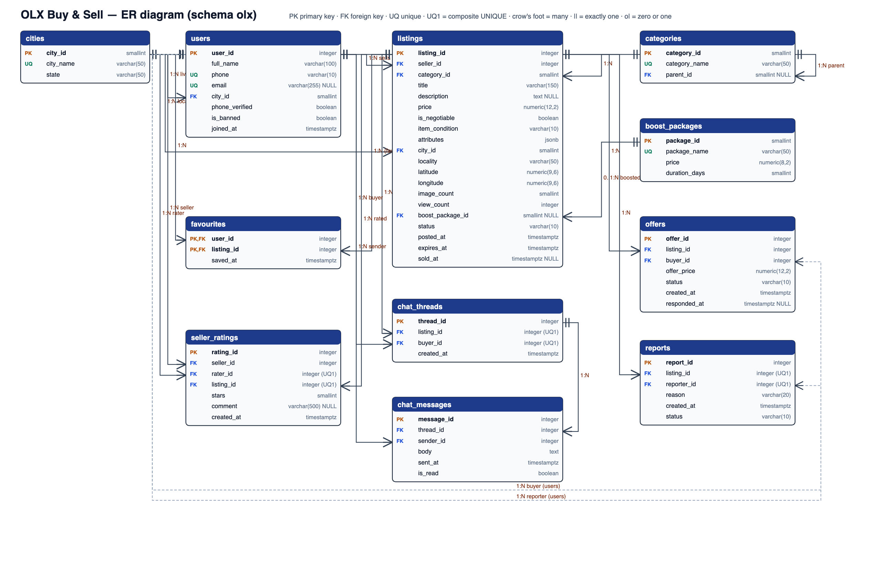
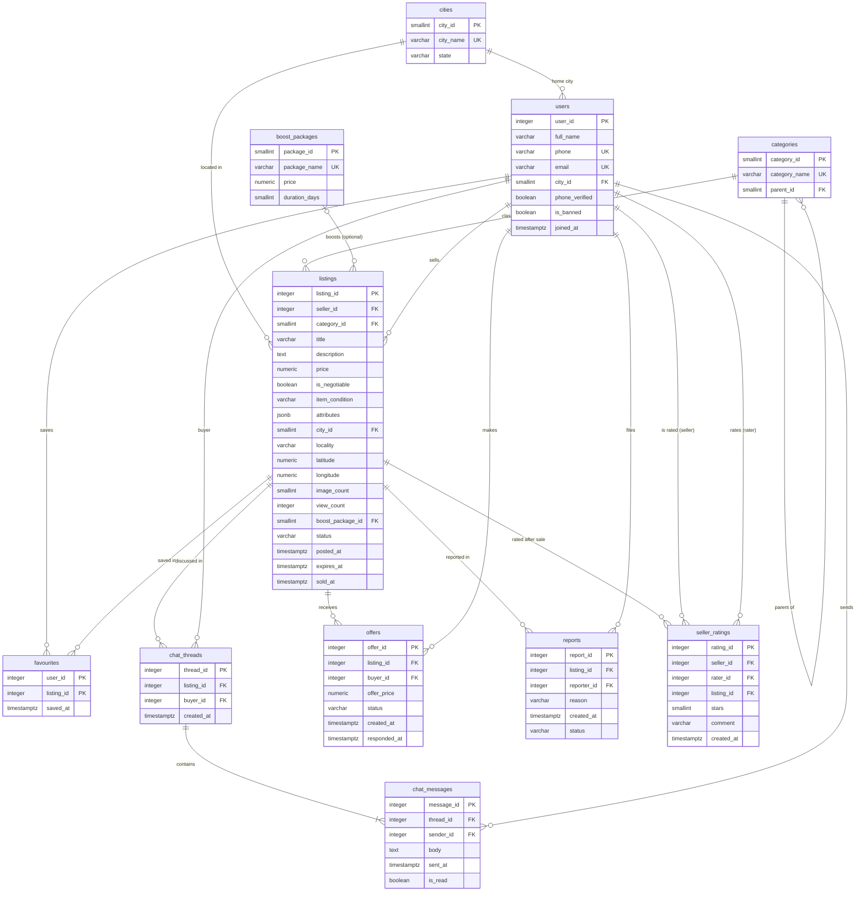

# 02 · Schema design (from the seed data)

Files: [`sql/01_schema.sql`](../sql/01_schema.sql) · [`sql/02_load_data.sql`](../sql/02_load_data.sql) · ER diagram [`diagrams/er_diagram.png`](../diagrams/er_diagram.png) (source [`er_diagram.svg`](../diagrams/er_diagram.svg); Mermaid below).
Tested on **PostgreSQL 18.6**. `01_schema.sql` runs on an empty database and `02_load_data.sql` loads all 11 files with **0 errors**. All 30 queries in `queries/workload_30.sql` run unchanged against this schema.

## 1. How we worked it out

1. We loaded every CSV into a scratch schema with all columns as `text`. For each column we counted NULLs, distinct values and maximum length, then listed the allowed values of every code column.
2. We checked candidate keys with `GROUP BY … HAVING count(*) > 1`, cross-table rules with joins, and value ranges with `min`/`max`.
3. We picked the tightest type and constraint that **all** seed rows satisfy and that the business needs, then reloaded into the real schema.

Key observations from the data:

| Observation | Count | Consequence |
|---|---:|---|
| `listings.sold_at` empty | 76,431 = every non-SOLD ad | `CHECK ((status='SOLD') = (sold_at IS NOT NULL))` |
| `offers.responded_at` empty | 162 = every PENDING offer | `CHECK ((status='PENDING') = (responded_at IS NULL))` |
| `listings.boost_package_id` empty | 110,565 (92%) | Optional FK. Most sellers don't pay; only 9,435 ads are boosted, all with packages 1–4. **Packages 5 and 6 were never bought.** |
| `listings.description` empty | 23,737 (20%) | Optional free text, NULL allowed |
| `users.email` empty | 24,885 (50%) | Users sign up with phone; email optional. UNIQUE still allowed (NULLs don't clash) |
| `seller_ratings.comment` empty | 5,589 (50%) | Stars are required, review text is optional |
| `categories.parent_id` empty | 5 | Top-level categories (Vehicles, Electronics, Home & Living, Fashion, Books & Sports) |
| duplicate `(listing_id, buyer_id)` in chat_threads | 0 | UNIQUE: one chat per buyer per ad |
| duplicate `(listing_id, reporter_id)` in reports | 0 | UNIQUE: one report per user per ad |
| duplicate `listing_id` in seller_ratings | 1,294 | Not unique alone. `(listing_id, rater_id)` has 0 duplicates, so that pair is UNIQUE |
| duplicate `(listing_id, buyer_id)` in offers | 2,662 | **Not** unique: a buyer can send several offers (counter-offers) |
| `attributes` JSON type | object in 120,000 rows | `CHECK (jsonb_typeof(attributes) = 'object')` |
| all timestamps | all `+05:30` | `timestamptz` |
| `expires_at − posted_at` | 30 days for 117,687 ads; 60–570 days for 2,313 | Only `expires_at > posted_at` is enforced (renewed ads exist) |

## 2. Data dictionary

`PK` primary key · `FK` foreign key (ON DELETE rule) · `UQ` unique · `NN` NOT NULL.

### cities (10)
| Column | Type | Constraint | Why |
|---|---|---|---|
| city_id | smallint | PK | 10 cities; 2 bytes is enough |
| city_name | varchar(50) | NN, UQ, not blank | Natural key; two cities with the same name would be ambiguous in filters |
| state | varchar(50) | NN, not blank | Every city is in a state (9 distinct; Mumbai and Pune share Maharashtra) |

### categories (12)
| Column | Type | Constraint | Why |
|---|---|---|---|
| category_id | smallint | PK | Small lookup table |
| category_name | varchar(50) | NN, UQ | Shown in menus, must be unique |
| parent_id | smallint | NULL, FK → categories **ON DELETE SET NULL**, CHECK ≠ category_id | NULL = top-level category. If a parent is deleted, its children become top level (R24's `coalesce` already handles that). A category can't be its own parent |

### boost_packages (6)
| Column | Type | Constraint | Why |
|---|---|---|---|
| package_id | smallint | PK | |
| package_name | varchar(50) | NN, UQ | Product name shown at checkout |
| price | numeric(8,2) | NN, CHECK > 0 | Money: exact decimal, never float. Range ₹99–₹1,499 |
| duration_days | smallint | NN, CHECK 1–365 | Range 3–60 days in the data |

### users (50,000)
| Column | Type | Constraint | Why |
|---|---|---|---|
| user_id | integer | PK | 50k now, 1M at 20×; integer is enough |
| full_name | varchar(100) | NN, not blank | Shown on ads and chats |
| phone | varchar(10) | NN, **UQ**, CHECK `^[6-9][0-9]{9}$` | Login identifier (R23). Valid Indian mobile number. varchar, not a number type, because it is a code, not a quantity |
| email | varchar(255) | NULL, **UQ**, CHECK format, CHECK lowercase | Optional. When present it must be unique. Stored in lowercase so UNIQUE is effectively case-insensitive |
| city_id | smallint | NN, FK → cities RESTRICT | Home city |
| phone_verified | boolean | NN, default false | `t`/`f` in the CSV |
| is_banned | boolean | NN, default false | Soft-ban; this is why users are never hard-deleted |
| joined_at | timestamptz | NN, default now() | Has a time-zone offset |

### listings (120,000)
| Column | Type | Constraint | Why |
|---|---|---|---|
| listing_id | integer | PK | W01 inserts id 90000001, which fits in integer |
| seller_id | integer | NN, FK → users **RESTRICT** | Never delete a seller who still has ads, chats or ratings. Ban instead |
| category_id | smallint | NN, FK → categories RESTRICT | Can't delete a category that is in use |
| title | varchar(150) | NN, not blank | Max 25 characters in the data; 150 leaves room |
| description | text | NULL | Optional (20% empty) |
| price | numeric(12,2) | NN, CHECK > 0 | Money; max ₹6.75 lakh now, cars can reach crores |
| is_negotiable | boolean | NN, default false | W01 omits it, so it needs a default |
| item_condition | varchar(10) | NN, CHECK IN (NEW, LIKE_NEW, GOOD, FAIR) | Short code, 4 values |
| attributes | jsonb | NN, default `{}`, CHECK object | Category-specific keys (cars: brand, fuel, km_driven, model, owners, transmission, year; mobiles: brand, model, storage_gb; …). `jsonb` because the keys differ per category and queries use `->>` |
| city_id | smallint | NN, FK → cities RESTRICT | Ad location |
| locality | varchar(50) | NN | Neighbourhood name |
| latitude | numeric(9,6) | NN, CHECK 6–38 | 6 decimals (≈ 0.1 m), India bounding box |
| longitude | numeric(9,6) | NN, CHECK 68–98 | India bounding box |
| image_count | smallint | NN, default 0, CHECK 0–20 | 0–11 in the data |
| view_count | integer | NN, default 0, CHECK ≥ 0 | Counter. W01 omits it, so it needs a default |
| boost_package_id | smallint | NULL, FK → boost_packages **RESTRICT** | NULL = not boosted. RESTRICT: a package that has been sold is billing history and must not be deleted |
| status | varchar(10) | NN, default ACTIVE, CHECK IN (ACTIVE, SOLD, EXPIRED, REMOVED) | REMOVED is the soft delete |
| posted_at | timestamptz | NN | |
| expires_at | timestamptz | NN, CHECK > posted_at | |
| sold_at | timestamptz | NULL, CHECK (SOLD ⇔ NOT NULL), CHECK ≥ posted_at | Empty unless the ad is sold |

### chat_threads (59,855)
| Column | Type | Constraint | Why |
|---|---|---|---|
| thread_id | integer | PK | |
| listing_id | integer | NN, FK → listings **CASCADE** | A chat has no meaning without its ad |
| buyer_id | integer | NN, FK → users RESTRICT | The seller's side of the chat must survive |
| created_at | timestamptz | NN | |
| (listing_id, buyer_id) | | **UQ** | Stops a buyer from opening two chats about the same ad |

### chat_messages (209,529)
| Column | Type | Constraint | Why |
|---|---|---|---|
| message_id | integer | PK | W03 inserts 90000001 |
| thread_id | integer | NN, FK → chat_threads **CASCADE** | Messages belong to their thread |
| sender_id | integer | NN, FK → users RESTRICT | Must be the buyer or the seller (integrity check IC2) |
| body | text | NN, CHECK not blank, ≤ 4000 characters | An empty message is not allowed |
| sent_at | timestamptz | NN | |
| is_read | boolean | NN, **default false** | W03 omits it, and a new message is unread |

### offers (19,943)
| Column | Type | Constraint | Why |
|---|---|---|---|
| offer_id | integer | PK | `(listing_id, buyer_id)` is **not** unique (2,662 repeats: counter-offers) |
| listing_id | integer | NN, FK → listings CASCADE | |
| buyer_id | integer | NN, FK → users RESTRICT | |
| offer_price | numeric(12,2) | NN, CHECK > 0 | Money |
| status | varchar(10) | NN, default PENDING, CHECK IN (PENDING, ACCEPTED, REJECTED, COUNTERED) | |
| created_at | timestamptz | NN | |
| responded_at | timestamptz | NULL, CHECK (PENDING ⇔ NULL), CHECK ≥ created_at | Empty exactly while the seller hasn't answered |

### favourites (70,000) — M:N between users and listings
| Column | Type | Constraint | Why |
|---|---|---|---|
| user_id | integer | **PK part 1**, FK → users **CASCADE** | Bookmarks are private to the user and can go with them |
| listing_id | integer | **PK part 2**, FK → listings CASCADE | |
| saved_at | timestamptz | NN | |

A composite PK `(user_id, listing_id)` is used because an ad is saved at most once per user. No surrogate id is needed.

### reports (7,999)
| Column | Type | Constraint | Why |
|---|---|---|---|
| report_id | integer | PK | |
| listing_id | integer | NN, FK → listings **RESTRICT** | Reports are moderation evidence; deleting a reported ad must be a deliberate act |
| reporter_id | integer | NN, FK → users RESTRICT | |
| reason | varchar(20) | NN, CHECK IN (SPAM, FRAUD, OFFENSIVE, WRONG_CATEGORY, ALREADY_SOLD) | |
| created_at | timestamptz | NN | |
| status | varchar(10) | NN, default OPEN, CHECK IN (OPEN, ACTIONED, DISMISSED) | |
| (listing_id, reporter_id) | | **UQ** | A user can report the same ad only once |

### seller_ratings (11,244)
| Column | Type | Constraint | Why |
|---|---|---|---|
| rating_id | integer | PK | |
| seller_id | integer | NN, FK → users RESTRICT | Redundant with `listings.seller_id` (see §4) |
| rater_id | integer | NN, FK → users RESTRICT, CHECK ≠ seller_id | A seller can't rate themselves |
| listing_id | integer | NN, FK → listings **RESTRICT** | Reputation must not disappear silently |
| stars | smallint | NN, CHECK 1–5 | |
| comment | varchar(500) | NULL | Optional review text |
| created_at | timestamptz | NN | |
| (listing_id, rater_id) | | **UQ** | The same deal is rated once per rater |

**Constraint count (from `pg_constraint`):** 11 PRIMARY KEY, 19 FOREIGN KEY, 8 UNIQUE, 29 CHECK and 64 NOT NULL. Every column is NOT NULL except the 7 that are optional by design (`categories.parent_id`, `users.email`, `listings.description`, `listings.boost_package_id`, `listings.sold_at`, `offers.responded_at`, `seller_ratings.comment`). The ≥12 meaningful ones the brief asks for include: conditions/statuses/reasons IN-lists (5), SOLD ⇔ `sold_at`, PENDING ⇔ `responded_at`, `expires_at > posted_at`, `sold_at ≥ posted_at`, `responded_at ≥ created_at`, `attributes` is an object, lat/long in India, image count 0–20, stars 1–5, no self-rating, phone format, and the UNIQUE rules on threads, reports and ratings.

### ON DELETE summary
| Rule | Where | Reason |
|---|---|---|
| RESTRICT | every FK to `users` except favourites; `listings` → cities/categories/boost_packages; `reports`/`seller_ratings` → listings | A user or ad is a party to *other people's* data (chats, offers, ratings, reports). Users are banned and ads are marked REMOVED instead of deleted |
| CASCADE | `favourites` → users/listings; `chat_threads`, `offers` → listings; `chat_messages` → chat_threads | Child rows have no meaning without the parent, and they are not evidence |
| SET NULL | `categories.parent_id` | Deleting a top-level group promotes its sub-categories, and no ad loses its category |

### Indexes that exist after `01_schema.sql` (all automatic, from PK/UNIQUE)
`*_pkey` on every table; `cities_city_name_key`, `categories_category_name_key`, `boost_packages_package_name_key`, `users_phone_key`, `users_email_key`, `chat_threads_listing_buyer_key (listing_id, buyer_id)`, `reports_listing_reporter_key (listing_id, reporter_id)`, `seller_ratings_listing_rater_key (listing_id, rater_id)`, `favourites_pkey (user_id, listing_id)`.
**No index on any FK column** (`listings.seller_id`, `chat_messages.thread_id`, …), which is deliberate for the Phase 3 baseline. Note that `users_phone_key` already serves R23 (login by phone), and `chat_threads_listing_buyer_key` already serves lookups by `listing_id`.

## 3. ER diagram

**Cardinalities:** city 1:N users and 1:N listings; category 1:N listings and 1:N sub-categories (self-relation); boost package 0..1:N listings (an ad has at most one package, and most have none); user 1:N listings (as seller); users M:N listings through **favourites**; listing 1:N chat_threads, and user 1:N chat_threads (as buyer), so a thread is the M:N "buyer talks about ad"; thread 1:N messages (at least 1 in the data); listing 1:N offers, reports and ratings; user 1:N offers, reports, and ratings given or received.

## 4. Functional dependencies and normal form

Every table has atomic columns and a primary key (**1NF**). The only non-atomic-looking column is `listings.attributes` (jsonb). We treat it as one atomic value (a document that is read or written as a whole and filtered with `->>`), because its keys differ per category. Splitting it into an EAV table would add a join to R02/R08 and lose typing. Every PK is a single column except `favourites` (where `saved_at` depends on the whole key `(user_id, listing_id)`), so no partial dependencies exist (**2NF**).

| Table | Functional dependencies (non-trivial) | Candidate keys | NF |
|---|---|---|---|
| cities | city_id → city_name, state; city_name → city_id, state | {city_id}, {city_name} | BCNF |
| categories | category_id → category_name, parent_id; category_name → category_id | {category_id}, {category_name} | BCNF |
| boost_packages | package_id → package_name, price, duration_days; package_name → package_id | {package_id}, {package_name} | BCNF |
| users | user_id → all; phone → all; email → all (when not NULL) | {user_id}, {phone}, {email} | BCNF |
| listings | listing_id → all other columns | {listing_id} | BCNF* |
| chat_threads | thread_id → listing_id, buyer_id, created_at; (listing_id, buyer_id) → thread_id, created_at | {thread_id}, {listing_id, buyer_id} | BCNF |
| chat_messages | message_id → thread_id, sender_id, body, sent_at, is_read | {message_id} | BCNF |
| offers | offer_id → all | {offer_id} | BCNF |
| favourites | (user_id, listing_id) → saved_at | {user_id, listing_id} | BCNF |
| reports | report_id → all; (listing_id, reporter_id) → report_id, reason, created_at, status | {report_id}, {listing_id, reporter_id} | BCNF |
| seller_ratings | rating_id → all; (listing_id, rater_id) → all; **listing_id → seller_id** | {rating_id}, {listing_id, rater_id} | **1NF only for `seller_id`** (partial dependency), kept on purpose, see below |

Every determinant above is a candidate key (BCNF), except for these derived or redundant columns:

1. **`seller_ratings.seller_id`**: `listing_id → seller_id` holds (the seller of the rated ad, checked by IC4: 0 mismatches). `listing_id` is part of the key `(listing_id, rater_id)`, so this is a *partial* dependency, and the table is strictly in 1NF for that column. **We keep it on purpose:** R04 and R21 read a seller's ratings by `seller_id` without joining 120k listings. The column never changes (a listing's seller is fixed), so update anomalies can't happen. Integrity is guarded by IC4 (it could also be enforced with a composite FK `(listing_id, seller_id) → listings(listing_id, seller_id)`, which needs an extra UNIQUE index on listings and is a Phase 4 decision).
2. **`listings.view_count`** is derived from page-view events that we don't store. Keeping a counter is the only option and is justified. It is not functionally dependent on any other column, so it does not break 3NF. It is a write hot-spot (every view is an UPDATE), noted for Phase 4/5.
3. **`chat_threads` vs the listing's seller:** the thread doesn't store `seller_id`, because it's derivable (`listing_id → seller_id` through listings). This is correct 3NF design, but it is the reason R06/R07 need a join to `listings` and an `OR` across two tables. That's a Phase 4 trade-off, not a schema bug.
4. **`listings.city_id` vs `users.city_id`:** these are **not** redundant. An ad's location is independent of the seller's home city.
5. *listings, BCNF\**: `latitude, longitude → city_id` would hold in the real world, but the data doesn't guarantee it and we don't treat it as an FD.

## 5. Load results

`psql -d olx -f sql/01_schema.sql && psql -d olx -f sql/02_load_data.sql` — no errors, all rows accepted.

| table | expected | loaded |
|---|---:|---:|
| cities | 10 | 10 |
| categories | 12 | 12 |
| boost_packages | 6 | 6 |
| users | 50,000 | 50,000 |
| listings | 120,000 | 120,000 |
| chat_threads | 59,855 | 59,855 |
| chat_messages | 209,529 | 209,529 |
| offers | 19,943 | 19,943 |
| favourites | 70,000 | 70,000 |
| reports | 7,999 | 7,999 |
| seller_ratings | 11,244 | 11,244 |

## 6. Integrity checks (run at the end of `02_load_data.sql`)

| # | Rule | Violations |
|---|---|---:|
| IC1 | A buyer never chats about their own ad | **0** |
| IC2 | Every message sender is the thread's buyer or the ad's seller | **0** |
| IC3 | No message before its thread, no thread before its ad was posted | **0** |
| IC4 | `seller_ratings.seller_id` = the listing's seller | **0** |
| IC5 | Only SOLD ads are rated, and never before `sold_at` | **0** |
| IC6 | A seller never makes an offer on their own ad | **0** |
| IC7 | A seller never reports their own ad | **0** |
| IC8 | Every rater chatted with the seller about that ad | **0** |
| IC9 | A user saves their own ad to favourites | **5** ⚠ |
| IC10 | Ad posted before the seller's account was created | **634** ⚠ |
| IC11 | Ads with more than one ACCEPTED offer | **419** ⚠ |
| IC12 | ACTIVE ads of banned sellers | **55** ⚠ |
| IC13 | ACTIVE ads already past `expires_at` on 1 July 2026 | **2,256** ⚠ |

## 7. Data problems found

None of these made the load fail, because they are cross-table or business-process issues that a CHECK cannot express. We report them rather than "fix" the data (the brief forbids changing data).

1. **Favourites on own ad (IC9, 5 rows):** a seller bookmarked their own listing. Harmless, but the app should block it.
2. **Ad before account (IC10, 634 ads):** `listings.posted_at < users.joined_at`. Most likely `joined_at` was overwritten (e.g. on account re-creation or migration). This is why we did not add such a rule.
3. **Several accepted offers on one ad (IC11, 419 ads):** a seller can only sell once. The app should reject the other pending offers when one is accepted (W05 does exactly that). Not enforced, so the seed data still loads.
4. **Banned sellers with live ads (IC12, 55 ads):** banning a user should also remove their active ads.
5. **Stale ACTIVE ads (IC13, 2,256):** the nightly expiry job hasn't run. W04 is that job.
6. **Locality doesn't match the city:** the same 16 localities (Adyar, Andheri, Koramangala, Saket, …) appear in every city, while the coordinates match the city. `locality` is noise in this export, so we kept it as plain text with no lookup table.
7. **Brand/model mismatch in titles and attributes:** e.g. *"OnePlus iPhone 13"* with `brand = OnePlus, model = iPhone 13`. This matters for R03/R08 (title search vs model filter), but it isn't a schema problem.
8. **Boost packages 5 and 6 have never been bought,** yet R13 (`NOT IN (SELECT boost_package_id …)`) returns **no rows**, because the sub-query contains NULLs (`x NOT IN (…, NULL)` is never TRUE). This is the "always empty" P5 report; we fix it in Phase 4 with `NOT EXISTS`.
9. **Expiry is not always 30 days:** 2,313 ads have 60–570-day lifetimes (renewals), so a fixed "posted + 30 days" CHECK would be wrong.
